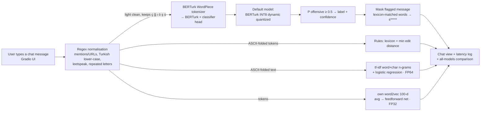

# SWE015 · Real-Time Chat Moderation (Turkish) — Use Case 4

Flags offensive messages in Turkish game chat **live, on a CPU-only server**, within a
**50 ms / message** latency budget. One task, four models of increasing sophistication, all
evaluated on the same held-out test set, with the **INT8-quantized BERTurk** running inside a
Gradio chat application.

| | |
|---|---|
| **Data** | OffensEval-TR 2020 (Çöltekin, 2020) — ~31.7k labelled training tweets, 3.5k official test tweets |
| **Task** | binary: `clean` (NOT) vs `offensive` (OFF) |
| **Metrics** | macro-F1 (imbalanced classes), per-message CPU latency |
| **Weights** | Hugging Face Hub: `https://huggingface.co/Yamfy/swe015-chat-moderation` |

## Quick start (single run command)

```bash
git clone https://github.com/Yamfy/swe015-chat-moderation.git
cd swe015-chat-moderation
python -m venv .venv && source .venv/bin/activate      # Windows: .venv\Scripts\activate
pip install -r requirements.txt
SWE015_HF_REPO=Yamfy/swe015-chat-moderation python app.py
```

Open http://127.0.0.1:7860. On first start the app downloads the trained weights from the
Hugging Face Hub into `artifacts/`.

## Reproduce training and results

Run [`colab_run_all.ipynb`](colab_run_all.ipynb) on Google Colab (T4 GPU), or locally:

```bash
python -m src.data          # download + split data
python train_classical.py   # lexicon + edit distance rules, tf-idf + logistic regression
python train_nn.py          # own word2vec + feedforward network (SGD + backprop)
python train_bert.py        # fine-tune BERTurk (GPU recommended)
python quantize_bert.py     # dynamic INT8 quantization
python evaluate.py          # all models on the same test set -> results/
python upload_weights.py Yamfy/swe015-chat-moderation   # needs HF_TOKEN
```

## Architecture



Everything runs on **CPU** in one Python process (`app.py`). Training ran on Google Colab (T4 GPU);
latency in `results/` was measured on CPU only (see `results/hardware.txt`).

## Technique map

| Area | Technique | Where in the code |
|---|---|---|
| **A** Neural networks | word2vec skip-gram with negative sampling, trained from scratch on the training messages; feedforward net (ReLU, dropout) trained with **SGD + backpropagation** | `src/w2v.py`, `train_nn.py` |
| **B** Classical NLP | regex normalisation (leetspeak, repeated letters, Turkish characters); tokenisation; lexicon learned with smoothed log-odds + **minimum edit distance** matcher (rule baseline); **tf-idf** + logistic regression baseline; cosine similarity for word2vec neighbours | `src/normalize.py`, `src/lexicon.py`, `train_classical.py` |
| **C** Transformers | **BERTurk** (`dbmdz/bert-base-turkish-cased`) fine-tuned with a classification head; WordPiece tokenizer; self-attention encoder | `train_bert.py`, `src/models.py` |
| **D** Efficient models | post-training **dynamic INT8 quantization** of all Linear layers; size + latency benchmark (≥100 runs) against a 50 ms CPU budget | `quantize_bert.py`, `evaluate.py` |

## Results

See [`results/results.md`](results/results.md) (generated by `evaluate.py`; every number comes
from that run). Misclassified test messages for error analysis: `results/errors_bert_int8.csv`.

## Repository layout

```
app.py               Gradio chat application (default: INT8 BERTurk)
src/config.py        paths, hyper-parameters, latency budget
src/data.py          download + split OffensEval-TR 2020
src/normalize.py     regex normalisation
src/lexicon.py       lexicon builder + edit-distance matcher
src/w2v.py           word2vec (SGNS) + feedforward network
src/models.py        common predict interface, quantization, weight download
train_*.py, quantize_bert.py, evaluate.py, upload_weights.py
colab_run_all.ipynb  end-to-end run on Colab
results/             metrics produced by evaluate.py
```

## Data and model sources

- Çağrı Çöltekin. 2020. *A Corpus of Turkish Offensive Language on Social Media.* LREC 2020.
  Data: https://coltekin.github.io/offensive-turkish/
- BERTurk: Stefan Schweter, `dbmdz/bert-base-turkish-cased`, https://huggingface.co/dbmdz/bert-base-turkish-cased
- Mikolov et al. 2013 (word2vec); Devlin et al. 2019 (BERT).

## AI usage

Claude (Anthropic) was used to help draft the code and the slides. All training runs, results and
the demo were produced and checked by me.
